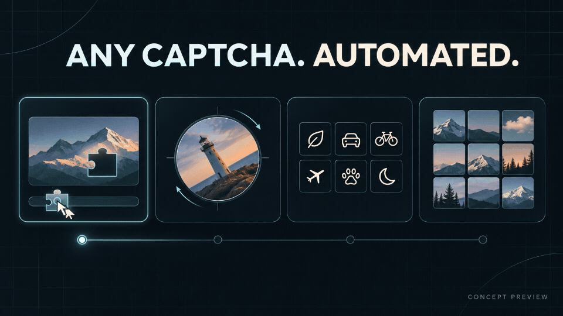

<div align="center">

# anycaptcha-autopass

**Automatically solve any CAPTCHA.**

Working toward this goal through continuously maintained solvers, browser automation, and site adapters.


English · [简体中文](README.zh-CN.md)

</div>

## Preview



Concept animation showing the automation flow across sliders, rotation, icon clicks, and image grids.

## From recognition to automated verification

**Read the image. Calculate the answer.** Local image algorithms, OCR, and ONNX models produce click coordinates, drag positions, or rotation angles. Semantic image selection uses a configurable vision model service.

**Operate the page. Check the result.** Playwright performs clicks, drags, and rotations. The current challenge's server receipt and page state determine the outcome, with bounded retries and recorded results.

Universal CAPTCHA automation is the project's ongoing goal. The following 11 challenge types are implemented today. Browser automation requires a matching site adapter, and success rates vary by challenge and site.

| Challenge | Recognition |
| --- | --- |
| Slider | Locate a gap and calculate horizontal movement |
| Ordered text clicks | Detect characters, match prompts, and order clicks |
| Single-image rotation | Predict image orientation and rotation angle |
| Dual-disc rotation | Calculate the relative angle between inner and outer discs |
| Overlap rotation | Align an original image with its center crop |
| Band restoration | Calculate the shift needed to restore a horizontal band |
| 2D dragging | Locate the target position for a single puzzle piece |
| Ordered icon clicks | Match icons in prompt order |
| Font differences | Identify characters with different stroke or hollow features |
| Word ordering | Reconstruct an idiom or verse using OCR and local vocabulary |
| Semantic grid | Select tiles with a vision model and drag them to the target |

## Quick start

The current runtime is **Linux with Python 3.12**. Install [uv](https://docs.astral.sh/uv/getting-started/installation/), then run these commands from the project root:

```sh
git clone https://github.com/IT-coder-Yy/anycaptcha-autopass.git
cd anycaptcha-autopass
bash setup.sh
./run.sh --help

# Generate a local restoration challenge, solve it, and operate the browser
./run.sh demo --site lab --kind restore --cases 1 --headless
```

Setup installs dependencies, Chromium, and models, then verifies model files. Initial setup requires network access. If Chromium reports missing system libraries, run `.venv/bin/python -m playwright install-deps chromium`; this may require administrator privileges.

Local font and word-order challenges require Noto Sans/Serif CJK fonts. The default font directory is `/usr/share/fonts/noto-cjk`, containing the corresponding `.ttc` font weights.

Semantic grid selection needs a vision model. Copy the template and fill in only the **endpoint, model name, and API key**:

```sh
cp .env.example .env
```

The project-root `.env` file is read automatically during semantic recognition. Other image solvers need no model service configuration. All other parameters have code defaults and do not belong in `.env`. Explicit process environment values take precedence; `.env` is excluded from Git.

## Integrate with your application

### Call a solver directly

Import the required challenge package. After `bash setup.sh`, run the following in the project virtual environment:

```python
import cv2
from drag2d.solver import drag_piece

background = cv2.imread("background.png")
piece = cv2.imread("piece.png", cv2.IMREAD_UNCHANGED)
result = drag_piece(background, piece)
print(result.to_dict())
```

Results include `usable`, `score`, `points` or `value`, a reason, and elapsed time. Your application performs the page interaction and checks the current challenge's server response. For process-based integration, see the JSON-lines protocol in [worker.py](worker.py).

### Ask an AI agent to integrate it

Give your agent access to this repository and your application, then replace the placeholders in this prompt:

```text
Integrate the <challenge type> solver from this CAPTCHA repository into my project.

CAPTCHA repository: <local path or repository URL>
Target project: <your project path>
Target page and inputs: <page URL, image/prompt sources, existing browser framework>
Invocation: <direct Python call or a separate process>

Read the challenge source and its actual dependencies first. Confirm input formats
and the meaning of output coordinates or angles. Reuse src/<challenge type>/ and
bring in only the required shared modules, models, and assets, preserving their
source records. Exclude unrelated solvers, historical experiments, and runtime data.
If a vision model is needed, configure only the endpoint, model name, and API key
listed in .env.example. Keep the code defaults for other parameters.
Implement coordinate conversion and click/drag actions for the target page.
Discard stale results after a challenge changes, and use the current challenge's
response to determine success. Validate with local examples or a test page.
Report changed files, a calling example, and test results.
```

## Development

Challenge packages live directly under `src/`:

```text
src/
├── slider/          # Slider gaps
├── text/            # Ordered text clicks
├── rotate_single/   # Single-image rotation
├── rotate_dual/     # Dual-disc rotation
├── rotate_overlap/  # Overlap rotation
├── restore/         # Band restoration
├── drag2d/          # 2D dragging
├── icon/            # Icon clicks and templates
├── font/            # Font differences
├── order/           # Word ordering and vocabulary
├── semantic/        # Semantic grid selection
├── common/          # Models, OCR, interaction, and shared evaluation
├── lab/             # Local challenge page and server-side judge
└── cli.py           # Command-line entry point
```

## Models and asset sources

The [model manifest](models/manifest.json) pins download URLs and SHA-256 hashes. Use the [downloader](tools/fetch_models.py) to obtain the weights; ONNX files are excluded from the source repository. The manifest records each model's origin and license status. Redistribution conditions for text and single-image rotation weights remain to be verified.

| Component | Source and accompanying records |
| --- | --- |
| Parts of slider, dual-disc, and voting algorithms | slider-captcha-lab; [included MIT license](src/common/LICENSE.slider-captcha-lab) |
| 13 icon templates | wenlng/go-captcha-assets; [asset notice](src/icon/assets/gocaptcha-shapes/NOTICE) and [Apache-2.0 license](src/icon/assets/gocaptcha-shapes/LICENSE) |
| Idiom and verse vocabulary | chinese-xinhua and chinese-poetry; [data notes and licenses](src/order/data/README.md) |
| Single-image rotation lab photos | Public scikit-image data; [sources and hashes](src/rotate_single/data/manifest.json) |
