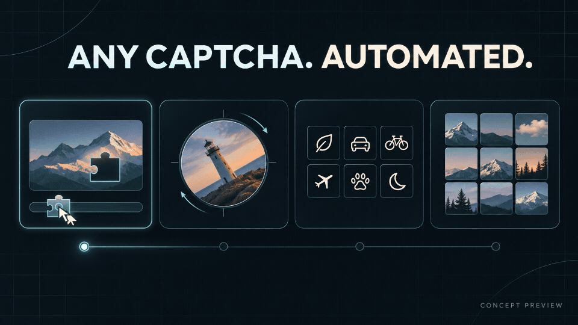

<div align="center">

# anycaptcha-autopass

**自动通过任何人机验证码。**

以此为目标，持续扩展题型识别、浏览器操作与站点适配。


[English](README.md) · 简体中文

</div>

## 效果预览



概念动图：从滑块、旋转到图标和九宫格，展示验证码自动化的处理过程。

## 从识别到自动验证

**给出题图，计算作答。** 通过本地图像算法、OCR 与 ONNX 模型，输出点击坐标、拖动位置或旋转角度；语义选图接入可配置的视觉模型服务。

**操作页面，核对结果。** 使用 Playwright 完成点击、拖拽和旋转，结合当前题目的服务端回执与页面状态判定结果，支持有限重试与运行记录。

项目持续向任意题型、任意站点的自动验证扩展。当前已实现以下 11 类题型；页面自动化需要对应站点适配，实际通过率取决于题型和站点。

| 题型 | 识别能力 |
| --- | --- |
| 缺口滑块 | 定位缺口，计算横向移动距离 |
| 顺序点字 | 检测字符、匹配提示并输出点击顺序 |
| 单图转正 | 预测图片方向与旋转角度 |
| 缺口双盘旋转 | 计算内外盘的相对旋转角度 |
| 重叠旋转 | 对齐原图与中心裁片 |
| 横带还原 | 计算移动横带的还原位移 |
| 二维拖拽 | 定位单块碎片的目标位置 |
| 图标点选 | 按提示顺序匹配图标 |
| 字体辨异 | 找出笔画或空心特征不同的文字 |
| 语序点选 | 根据 OCR 与成语、诗句词库恢复顺序 |
| 语义九宫格 | 通过视觉模型选图并拖入目标区域 |

## 快速开始

当前运行环境为 **Linux + Python 3.12**。先安装 [uv](https://docs.astral.sh/uv/getting-started/installation/)，在项目根目录执行：

```sh
git clone https://github.com/IT-coder-Yy/anycaptcha-autopass.git
cd anycaptcha-autopass
bash setup.sh
./run.sh --help

# 自动生成一道本地还原题，识别并操作浏览器完成验证
./run.sh demo --site lab --kind restore --cases 1 --headless
```

安装脚本会准备依赖、Chromium 和模型，并校验模型文件。首次安装需要网络；如 Chromium 报缺少系统依赖，可执行 `.venv/bin/python -m playwright install-deps chromium` 安装，可能需要系统管理员权限。

字体和语序的本地题库需要 Noto Sans/Serif CJK 字体，默认读取 `/usr/share/fonts/noto-cjk` 目录中对应字重的 `.ttc` 文件。

语义九宫格需要配置视觉模型。复制模板并填写 **模型地址、模型名、API Key** 三项即可：

```sh
cp .env.example .env
```

语义识别时会自动读取项目根目录的 `.env`；普通图像算法无需填写。其余参数已有代码默认值，不需要放进 `.env`。已设置的进程环境变量优先，`.env` 不会提交到仓库。

## 接入自己的程序

### 直接调用题型算法

各题型可直接作为 Python 模块使用。执行 `bash setup.sh` 后，在项目虚拟环境中运行：

```python
import cv2
from drag2d.solver import drag_piece

background = cv2.imread("background.png")
piece = cv2.imread("piece.png", cv2.IMREAD_UNCHANGED)
result = drag_piece(background, piece)
print(result.to_dict())
```

结果包含 `usable`、`score`、`points` 或 `value`、原因和耗时。业务程序根据这些结果完成页面操作，并核对当前题目的服务端回执。需要独立进程集成时，可参考 [worker.py](worker.py) 的 JSON 行协议。

### 让 AI Agent 帮你接入

把本仓库和你的项目交给 AI Agent，替换下面的占位内容后发送：

```text
请将这个验证码仓库中的「<题型>」接入我的项目。

验证码仓库位置：<本地路径或仓库地址>
目标项目位置：<你的项目路径>
目标页面和输入：<页面地址、题图/提示图来源、已有浏览器自动化框架>
期望调用方式：<直接 Python 调用，或通过独立进程调用>

先阅读该题型源码与实际依赖，确认输入格式、输出坐标或角度含义。
优先复用 src/<题型>/ 的现有算法，只引入必需的公共模块、模型和资源，
保留随附的来源说明；不要引入其他题型、历史实验或运行数据。
如需视觉模型，只配置 .env.example 中的模型地址、模型名和 API Key。
其余参数沿用代码默认值，结合目标页面实现坐标换算与点击/拖动适配。
题目变化后丢弃旧结果，并用当前题目的回执判断是否验证通过。
用本地样例或测试页面验证接入结果，说明修改文件、调用示例和测试结果。
```

## 开发

题型直接按目录组织：

```text
src/
├── slider/          # 缺口滑块
├── text/            # 顺序点字
├── rotate_single/   # 单图转正
├── rotate_dual/     # 双盘旋转
├── rotate_overlap/  # 重叠旋转
├── restore/         # 横带还原
├── drag2d/          # 二维拖拽
├── icon/            # 图标点选与模板
├── font/            # 字体辨异
├── order/           # 语序点选与词库
├── semantic/        # 语义九宫格
├── common/          # 模型、OCR、交互与公共评测流程
├── lab/             # 本地题库页面和服务端裁判
└── cli.py           # 命令行入口
```

## 模型与素材来源

模型由 [清单](models/manifest.json) 固定下载地址和 SHA-256，通过 [下载器](tools/fetch_models.py) 获取；ONNX 权重不随源码提交。清单逐项记录来源与许可状态，点字及单图旋转权重仍有待核实的再分发条件。

| 组件 | 来源与随附说明 |
| --- | --- |
| 部分滑块、双盘旋转及投票算法 | slider-captcha-lab；[随附 MIT 许可](src/common/LICENSE.slider-captcha-lab) |
| 13 张图标模板 | wenlng/go-captcha-assets；[素材版权说明](src/icon/assets/gocaptcha-shapes/NOTICE)、[Apache-2.0 许可](src/icon/assets/gocaptcha-shapes/LICENSE) |
| 成语与诗句词库 | chinese-xinhua、chinese-poetry；[数据说明与许可](src/order/data/README.md) |
| 单图旋转题库照片 | scikit-image 公开数据；[来源及哈希](src/rotate_single/data/manifest.json) |
